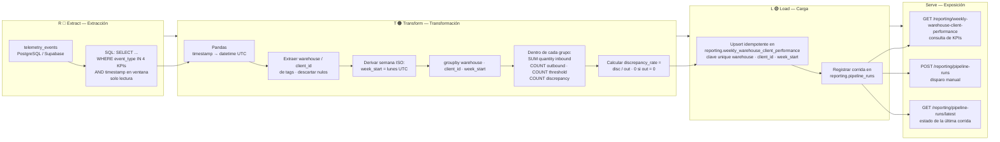

# Pipeline Design — Reporte Semanal de Desempeño por Almacén y Cliente

> **Empresa:** TrackFlow — Logística de almacén y última milla (Los Ángeles + Zaragoza)
> **Documento:** Diseño del pipeline de desempeño de negocio, Fase 1
> **Contexto:** TrackFlow Tech — Unidad de ingeniería interna

---

## Fase 1 — Análisis del estado actual

### 1.1 Estado actual de la telemetría

#### Eventos de telemetría capturados

TrackFlow dispone de un sistema de telemetría operativo basado en la tabla `telemetry_events` en Supabase (PostgreSQL). El plan de telemetría (Fases 1-3) identificó **45 oportunidades** en **9 dominios**, de las cuales **18 fueron seleccionadas** para instrumentación con schemas JSON completos y validación programática.

En la actualidad, los siguientes eventos están instrumentados de punta a punta (envelope → ingesta → almacenamiento → consulta):

| Dominio | Eventos instrumentados | Estado |
|---------|----------------------|--------|
| 📦 Inventario | `inbound_order_created`, `outbound_order_created`, `outbound_order_insufficient_stock`, `stock_threshold_triggered` | ✅ Capturando |
| 🔐 Autenticación | `login_succeeded`, `login_failed`, `session_token_expired` | ✅ Capturando |
| 📊 Rendimiento | `api_response_error_recorded` (4xx + 5xx por endpoint) | ✅ Capturando |
| 🧭 Navegación | `page_navigated` | ✅ Capturando |

Además, existen **eventos aprobados en schema pero NO instrumentados** por ausencia de camino de UI:
- `direct_stock_edit_rejected` (no hay edición directa de stock en el backoffice actual)
- `inventory_discrepancy_detected` (no hay flujo de auditoría/conteo físico implementado)

#### Almacenamiento

Los eventos se almacenan en la tabla `telemetry_events` con el siguiente esquema:

```sql
CREATE TABLE telemetry_events (
    id          uuid        PRIMARY KEY DEFAULT gen_random_uuid(),
    timestamp   timestamptz NOT NULL,
    service     text        NOT NULL,
    event_type  text        NOT NULL,
    level       text        NOT NULL DEFAULT 'info',
    value       numeric     NULL,
    message     text        NULL,
    tags        jsonb       NOT NULL DEFAULT '{}'
);
```

**Características clave:**
- **Inmutabilidad:** solo INSERT — nunca UPDATE/DELETE. Cada evento es una pieza de evidencia irreversible.
- **Índices analíticos:** `timestamp DESC`, `event_type`, y `GIN` sobre `tags` (JSONB) para consultas dimensionales.
- **Tags como almacén dimensional:** las propiedades del envelope (`warehouse`, `client_id`, `product_id`, `product_category`, `quantity`, etc.) se almacenan dentro de la columna `tags` como JSONB.
- **Nivel de severidad:** cada evento lleva un `level` derivado (`info`, `warn`, `error`) que permite filtrar calidad técnica sin depender del `event_type`.

#### Endpoint de reporte técnico existente: `GET /telemetry/report`

El reporte técnico actual responde **preguntas operacionales para ingeniería**. Está servido por un pipeline de análisis en `services/telemetry/analysis.py` que sigue la receta `cargar (SQL) → refinar (Pandas) → convertir tipos → agrupar → agregar → servir`.

**Métricas que responde hoy:**

| Métrica | Pregunta operacional | Granularidad |
|---------|---------------------|-------------|
| `events_per_day` | ¿Qué volumen de telemetría entra cada día? | Diario, global |
| `events_per_type_per_day` | ¿Qué tipos de evento dominan el tráfico y cómo evolucionan? | Diario, por `event_type` |
| `error_rate_daily` | ¿Qué fracción de eventos indica un problema técnico? | Diario, global |
| `error_rate_by_type` | ¿Qué tipo de evento concentra más fallos? | Por `event_type` |
| `api_errors_by_endpoint` | ¿Qué endpoints de API fallan más? | Por `endpoint` (en tags) |
| `auth_failure_rate` | ¿Qué fracción de intentos de login fallan cada día? | Diario, global |

**Estructura de la respuesta:**

```json
{
  "period": { "from": "2026-10-14T00:00:00Z", "to": "2026-10-21T00:00:00Z" },
  "metrics": {
    "events_per_day": [
      { "date": "2026-10-14", "events": 42 },
      ...
    ],
    "events_per_type_per_day": [
      { "date": "2026-10-14", "event_type": "inbound_order_created", "events": 5 },
      ...
    ],
    "error_rate_daily": [
      { "date": "2026-10-14", "total": 42, "errors": 3, "error_rate": 0.0714 },
      ...
    ],
    "auth_failure_rate": [
      { "date": "2026-10-14", "attempts": 15, "failures": 2, "failure_rate": 0.1333 },
      ...
    ]
  }
}
```

**Cache:** TTL de 60 segundos en memoria (clave por ventana de fechas). El endpoint no recalcula si la misma ventana se solicita dentro del TTL.

**Dashboard técnico:** `uis/backoffice/telemetry/` — vista HTML minimalista que consume el endpoint y muestra las métricas en tablas, con selector de ventana temporal.

#### Limitaciones del reporte técnico actual

1. **No tiene dimensión de cliente ni almacén.** El reporte opera a nivel global de sistema. Para calcular KPIs por `warehouse` + `client_id`, se necesita extraer estas dimensiones de `tags` y agrupar — algo que el pipeline actual no hace.
2. **Granularidad diaria, no semanal.** El reporte técnico usa `dt.date`. El negocio necesita semana ISO (lunes a domingo).
3. **No incluye `inventory_discrepancy_detected`.** Este evento está aprobado en schema pero no instrumentado ni usado en ninguna métrica del pipeline. Es necesario para la tasa de discrepancia.
4. **No produce agregaciones precalculadas.** Cada request calcula sobre la marcha. Un reporte semanal necesita una tabla materializada (`reporting.weekly_warehouse_client_performance`) para que el CEO pueda consultar sin depender del pipeline de análisis.

---

### 1.2 Identificación de la brecha: preguntas de negocio no respondidas

El `Brifing-pipeline.md` define 4 KPIs de negocio que **Thomas (CEO) y Ana (Head of Warehouse Operations)** necesitan semanalmente. El reporte técnico actual no responde ninguna de estas preguntas:

| # | Pregunta de negocio (Briefing) | ¿Lo responde el reporte técnico actual? | Dimensión faltante |
|---|-------------------------------|----------------------------------------|-------------------|
| 1 | **Volumen de entrada:** ¿cuántas unidades de mercancía de cada cliente recibió cada almacén esta semana? | ❌ — El reporte cuenta *eventos*, no suma *quantities*. No desglosa por `warehouse` + `client_id`. | `SUM(properties.quantity)` agrupado por `warehouse` y `client_id`, en ventana semanal |
| 2 | **Throughput de salida:** ¿cuántos pedidos preparó y despachó cada almacén para cada cliente esta semana? | ❌ — Mide eventos globales, no conteo de `outbound_order_created` por cliente/almacén. | `COUNT(outbound_order_created)` agrupado por `warehouse` + `client_id`, semanal |
| 3 | **Frecuencia de quiebre de stock:** ¿cuántas veces cayó un SKU por debajo del mínimo en cada almacén/cliente esta semana? | ❌ — `stock_threshold_triggered` existe pero nunca se agrega por cliente/almacén. | `COUNT(stock_threshold_triggered)` agrupado por `warehouse` + `client_id`, semanal |
| 4 | **Tasa de discrepancia:** ¿qué proporción de pedidos de salida tuvo una discrepancia de inventario detectada? | ❌ — `inventory_discrepancy_detected` ni siquiera está instrumentado. No existe el numerador ni el denominador. | `COUNT(inventory_discrepancy_detected) / COUNT(outbound_order_created)`, semanal |

**Brecha fundamental:** el reporte técnico existente fue diseñado explícitamente para NO responder preguntas de negocio (tele-report.md: *"Esto **no** es el reporte para el CEO. Nada de tasas de conversión ni ingresos — eso lo vamos a construir con los pipelines de datos más adelante"*). Su audiencia es Andrés (CTO) y el equipo de ingeniería. El pipeline que necesitamos construir está dirigido a Thomas y Ana, con una frecuencia, granularidad y conjunto de KPIs completamente distintos.

#### Mapa de correspondencia: eventos crudos → KPIs de negocio

| Evento `telemetry_events` | Campo en tags | KPI que alimenta | Operación de agregación |
|--------------------------|--------------|-----------------|----------------------|
| `inbound_order_created` | `quantity` | Volumen de entrada | `SUM(quantity)` por almacén/cliente/semana |
| `outbound_order_created` | — (conteo) | Throughput de salida + denominador de tasa de discrepancia | `COUNT(event)` por almacén/cliente/semana |
| `stock_threshold_triggered` | — (conteo) | Frecuencia de quiebre de stock | `COUNT(event)` por almacén/cliente/semana |
| `inventory_discrepancy_detected` | — (conteo) | Numerador de tasa de discrepancia | `COUNT(event)` por almacén/cliente/semana |

#### Lo que el pipeline de negocio necesita y el reporte técnico no provee

| Dimensión | Reporte técnico (existe) | Pipeline de negocio (a construir) |
|-----------|------------------------|----------------------------------|
| **Audiencia** | Andrés (CTO), ingeniería | Thomas (CEO), Ana (Operations) |
| **Preguntas** | ¿Está sano el sistema? | ¿Está funcionando el almacén? |
| **Granularidad** | Diaria | Semanal (ISO) |
| **Dimensiones** | Global, por `event_type`, por `endpoint` | Por `warehouse` + `client_id` |
| **Agregación** | Conteo de eventos, tasas técnicas | Suma de cantidades, conteo de pedidos, tasas de negocio |
| **Persistencia** | Cálculo bajo demanda (caché 60s) | Tabla materializada (`reporting.weekly_*`) |
| **Eventos necesarios** | 6 tipos (técnicos + auth) | 4 tipos (inventario + discrepancia) |
| **Endpoint** | `GET /telemetry/report` | `GET /reporting/weekly-warehouse-client-performance` |
| **Servicio** | `services/telemetry/` | `services/reporting/` (nuevo) |

**Conclusión de la brecha:** El reporte técnico actual y el pipeline de negocio que describe el `Brifing-pipeline.md` son **ortogonales** — comparten la fuente de datos (`telemetry_events`) pero responden preguntas distintas, para audiencias distintas, con frecuencias y granularidades distintas. No hay solapamiento funcional. La deuda técnica identificada es que `inventory_discrepancy_detected` no está instrumentado en el frontend, lo que será necesario abordar para que el pipeline de discrepancia tenga datos reales.

---

## Fase 2 — Diseño del pipeline

### 2.1 Propósito del pipeline

> **Producir el consolidado semanal que alimenta el "Reporte Semanal de Desempeño por Almacén y Cliente" de Thomas (CEO) y Ana (Head of Warehouse Operations)**, calculando los 4 KPIs de negocio del `Brifing-pipeline.md` (volumen de entrada, throughput de salida, frecuencia de quiebre de stock y tasa de discrepancia) a partir de las métricas obligatorias de telemetría (`inbound_order_created`, `outbound_order_created`, `stock_threshold_triggered`, `inventory_discrepancy_detected`), agregadas por `warehouse` + `client_id` por semana ISO.

**Desglose rastreable (cada KPI → su métrica de telemetría obligatoria):**

| KPI (Brifing-pipeline.md §2) | Métrica(s) obligatoria(s) de telemetría (CONTEXT-TELE.md §3) | Agregación |
|------------------------------|--------------------------------------------------------------|-----------|
| **Volumen de entrada** | `inbound_order_created` | `SUM(tags.quantity)` |
| **Throughput de salida** | `outbound_order_created` | `COUNT(event)` |
| **Frecuencia de quiebre de stock** | `stock_threshold_triggered` | `COUNT(event)` |
| **Tasa de discrepancia** | `inventory_discrepancy_detected` (numerador) / `outbound_order_created` (denominador) | `COUNT(disc) / COUNT(out)` |

### 2.2 Formato de extracción (fuentes)

**Fuente primaria — `telemetry_events` (Supabase/PostgreSQL):**

- **Formato del dato:** filas normalizadas con columnas fijas, y las dimensiones de negocio dentro de la columna `tags` (JSONB):

  ```sql
  SELECT timestamp, event_type, level, value, message, tags
  FROM telemetry_events
  ```

  Las propiedades del envelope del plan de telemetría (`warehouse`, `client_id`, `product_id`, `product_category`, `quantity`, `reference`, `exit_type`, `threshold_value`, `current_stock`, `expected_quantity`, `actual_quantity`, `variance`) llegan como claves de `tags` (JSONB).

- **Frecuencia de actualización de la fuente:** los eventos se **insertan en tiempo real** vía `POST /telemetry/events` desde el frontend (batch + `sendBeacon`), en **modo append-only** — cada evento es inmutable. El dato no se actualiza en el lugar; el snapshot cambia continuamente a medida que se emiten nuevos eventos.

**Fuentes secundarias (dominio) disponibles si son necesarias:**
- `inventory` (SKUs/StockEntry/StockExit en `services/user-api`) — para validar clientes/almacenes reales o enriquecer con `client_name` si el reporte quiere mostrar nombre de marca y no solo `client_id`. En la v1 **no se requieren** (el Briefing limita el alcance a `telemetry_events`), pero se documentan como opción de enriquecimiento futura.

**Modo de acceso:** el pipeline lee en **modo solo lectura**. Nunca escribe de vuelta en `telemetry_events` (restricción de negocio, Brifing-pipeline.md §7).

### 2.3 Flujo de datos (Extracción → Transformación → Carga)



**Tres etapas claramente separadas:**

| Etapa | Entrada → Salida | Responsabilidad |
|-------|-----------------|-----------------|
| **Extracción** | `telemetry_events` → DataFrame crudo tipado | SQL con filtros de `event_type` y ventana `timestamp` (inicio inclusivo / fin exclusivo, UTC). Solo lee las filas necesarias; nunca carga la tabla completa. |
| **Transformación** | DataFrame crudo → `week_start`, dimensiones y 5 campos calculados | Tipado UTC, extracción dimensional de `tags`, derivación de semana ISO, `groupby` + agregación, cálculo de la tasa. |
| **Carga** | Resultado agregado → `reporting.weekly_warehouse_client_performance` | Upsert idempotente por la clave única `(warehouse, client_id, week_start)`, más registro de corrida en `reporting.pipeline_runs`. |

### 2.4 Manejo de fuentes que actualizan registros (estrategia anti-duplicados)

`telemetry_events` es **append-only**: aquí el problema de "actualizar en el lugar" no se da porque los eventos nunca se modifican ni se borran. Después de correr el pipeline dos veces sobre la misma semana, **no debe duplicarse ninguna fila** en `reporting`. Estrategia concreta:

1. **Clave de idempotencia natural:** el grano de la tabla destino es único por `(warehouse, client_id, week_start)`. Si la misma semana se recalcula, el resultado agrega la misma información y debe **sobrescribir**, no insertar una segunda fila.

2. **Upsert (INSERT ... ON CONFLICT) apoyado en el constraint `unique (warehouse, client_id, week_start)`**:

   ```sql
   insert into reporting.weekly_warehouse_client_performance (
     warehouse, client_id, week_start,
     inbound_units_count, outbound_orders_count,
     stockout_events_count, discrepancy_events_count,
     discrepancy_rate
   )
   select ...  -- agregación del pipeline
   on conflict (warehouse, client_id, week_start)
   do update set
     inbound_units_count = excluded.inbound_units_count,
     outbound_orders_count = excluded.outbound_orders_count,
     stockout_events_count = excluded.stockout_events_count,
     discrepancy_events_count = excluded.discrepancy_events_count,
     discrepancy_rate = excluded.discrepancy_rate;
   ```

3. **Por qué no se duplica ni siquiera ante re-corridas parciales:** aunque el pipeline se ejecute dos veces y entre una ventana de datos que ya fue agregada, `ON CONFLICT` convierte el intento de duplicado en una **actualización in situ** de la única fila del grano. El resultado final siempre refleja la última corrida completa.

4. **Si en el futuro una fuente de dominio insertara actualizaciones de un evento (p.ej. `outbound_order_created` re-emitido):** el data contract inmutable del plan de telemetría (§8.1 "eventos inmutables") descarta esa posibilidad para este pipeline. Aun así, la defensa de negocio es la misma: el `eventId` del envelope es el dato fuente; la agregación es por grano semanal, por lo que una re-emisión legítima (corrección) quedaría absorbida como parte de la misma semana y sobrescrita por el upsert.

### 2.5 Tablas de destino nuevas (esquema `reporting`)

**Tabla única del entregable** — nombre exacto de la sección *Destination table* del `Brifing-pipeline.md` §5:

```sql
create table reporting.weekly_warehouse_client_performance (
  id uuid primary key default gen_random_uuid(),
  warehouse text not null,
  client_id text not null,
  week_start date not null,
  inbound_units_count integer not null default 0,
  outbound_orders_count integer not null default 0,
  stockout_events_count integer not null default 0,
  discrepancy_events_count integer not null default 0,
  discrepancy_rate numeric not null default 0,
  computed_at timestamptz not null default now(),
  unique (warehouse, client_id, week_start)
);
```

**Tabla de apoyo para historial/estado de corridas** (reutiliza el patrón que el propio Briefing sugiere en §6):

```sql
create table reporting.pipeline_runs (
  id uuid primary key default gen_random_uuid(),
  pipeline text not null default 'weekly_warehouse_client_performance',
  status text not null default 'running',   -- running | success | failed
  started_at timestamptz not null default now(),
  finished_at timestamptz,
  processed_events integer not null default 0,
  rows_upserted integer not null default 0,
  error_message text
);
```

> Ambos esquemas están **completamente separados** de `telemetry_events`: el pipeline jamás escribe ahí, y la tabla reporting es la única fuente de verdad del entregable semanal.

### 2.6 Endpoints nuevos en `services/reporting/`

Módulo **nuevo** `services/reporting/` — separado de `services/telemetry/` y de `GET /telemetry/report`:

| Método | Ruta | Propósito | Relación con `telemetry_events` |
|--------|------|-----------|-------------------------------|
| `GET` | `/reporting/weekly-warehouse-client-performance` | **Consulta de KPIs:** acepta `week_start` opcional (por defecto la semana calculada más reciente); devuelve todas las combinaciones almacén/cliente de esa semana | Lee **solo** la tabla `reporting.*` materializada — nunca lee `telemetry_events` |
| `GET` | `/reporting/pipeline-runs/latest` | **Estado:** metadata de la última corrida del pipeline (status, fechas, eventos procesados, filas upserted) | Lee `reporting.pipeline_runs` |
| `POST` | `/reporting/pipeline-runs` | **Disparo manual:** ejecuta la extracción → transformación → carga y registra la corrida | Ejecuta el pipeline que **lee** `telemetry_events` en solo lectura y **escribe** en `reporting.*` |

**Separación explícita:**
- `services/telemetry/analysis.py` y `GET /telemetry/report` **no se modifican** (restricción del Brifing-pipeline.md §7).
- `services/reporting/` tiene su propio pipeline (p. ej. `pipeline.py`), su propio router y su propia lógica de carga; el único punto de contacto con telemetría es la **lectura** de `telemetry_events` en la etapa de extracción.
- Se reutiliza el patrón de cache del reporte técnico (TTL) solo para la **consulta** de KPIs, no para la corrida del pipeline: la corrida siempre recalcula; la consulta sirve valores ya materializados.