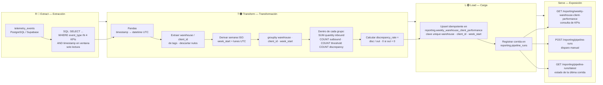
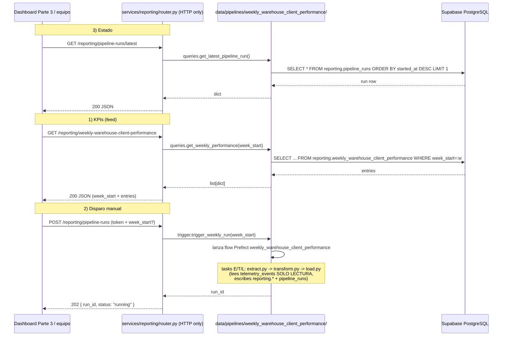

# Pipeline Design — Reporte Semanal de Desempeño por Almacén y Cliente

> **Empresa:** TrackFlow — Logística de almacén y última milla (Los Ángeles + Zaragoza)
> **Documento:** Diseño del pipeline de desempeño de negocio, Fase 1
> **Contexto:** TrackFlow Tech — Unidad de ingeniería interna

---

## Fase 1 — Análisis del estado actual

### 1.1 Estado actual de la telemetría

#### Eventos de telemetría capturados

TrackFlow dispone de un sistema de telemetría operativo basado en la tabla `telemetry_events` en Supabase (PostgreSQL). El plan de telemetría (Fases 1-3) identificó **45 oportunidades** en **9 dominios**, de las cuales **18 fueron seleccionadas** para instrumentación con schemas JSON completos y validación programática.

En la actualidad, los siguientes eventos están instrumentados de punta a punta (envelope → ingesta → almacenamiento → consulta):

| Dominio | Eventos instrumentados | Estado |
|---------|----------------------|--------|
| 📦 Inventario | `inbound_order_created`, `outbound_order_created`, `outbound_order_insufficient_stock`, `stock_threshold_triggered` | ✅ Capturando |
| 🔐 Autenticación | `login_succeeded`, `login_failed`, `session_token_expired` | ✅ Capturando |
| 📊 Rendimiento | `api_response_error_recorded` (4xx + 5xx por endpoint) | ✅ Capturando |
| 🧭 Navegación | `page_navigated` | ✅ Capturando |

Además, existen **eventos aprobados en schema pero NO instrumentados** por ausencia de camino de UI:
- `direct_stock_edit_rejected` (no hay edición directa de stock en el backoffice actual)
- `inventory_discrepancy_detected` (no hay flujo de auditoría/conteo físico implementado)

#### Almacenamiento

Los eventos se almacenan en la tabla `telemetry_events` con el siguiente esquema:

```sql
CREATE TABLE telemetry_events (
    id          uuid        PRIMARY KEY DEFAULT gen_random_uuid(),
    timestamp   timestamptz NOT NULL,
    service     text        NOT NULL,
    event_type  text        NOT NULL,
    level       text        NOT NULL DEFAULT 'info',
    value       numeric     NULL,
    message     text        NULL,
    tags        jsonb       NOT NULL DEFAULT '{}'
);
```

**Características clave:**
- **Inmutabilidad:** solo INSERT — nunca UPDATE/DELETE. Cada evento es una pieza de evidencia irreversible.
- **Índices analíticos:** `timestamp DESC`, `event_type`, y `GIN` sobre `tags` (JSONB) para consultas dimensionales.
- **Tags como almacén dimensional:** las propiedades del envelope (`warehouse`, `client_id`, `product_id`, `product_category`, `quantity`, etc.) se almacenan dentro de la columna `tags` como JSONB.
- **Nivel de severidad:** cada evento lleva un `level` derivado (`info`, `warn`, `error`) que permite filtrar calidad técnica sin depender del `event_type`.

#### Endpoint de reporte técnico existente: `GET /telemetry/report`

El reporte técnico actual responde **preguntas operacionales para ingeniería**. Está servido por un pipeline de análisis en `services/telemetry/analysis.py` que sigue la receta `cargar (SQL) → refinar (Pandas) → convertir tipos → agrupar → agregar → servir`.

**Métricas que responde hoy:**

| Métrica | Pregunta operacional | Granularidad |
|---------|---------------------|-------------|
| `events_per_day` | ¿Qué volumen de telemetría entra cada día? | Diario, global |
| `events_per_type_per_day` | ¿Qué tipos de evento dominan el tráfico y cómo evolucionan? | Diario, por `event_type` |
| `error_rate_daily` | ¿Qué fracción de eventos indica un problema técnico? | Diario, global |
| `error_rate_by_type` | ¿Qué tipo de evento concentra más fallos? | Por `event_type` |
| `api_errors_by_endpoint` | ¿Qué endpoints de API fallan más? | Por `endpoint` (en tags) |
| `auth_failure_rate` | ¿Qué fracción de intentos de login fallan cada día? | Diario, global |

**Estructura de la respuesta:**

```json
{
  "period": { "from": "2026-10-14T00:00:00Z", "to": "2026-10-21T00:00:00Z" },
  "metrics": {
    "events_per_day": [
      { "date": "2026-10-14", "events": 42 },
      ...
    ],
    "events_per_type_per_day": [
      { "date": "2026-10-14", "event_type": "inbound_order_created", "events": 5 },
      ...
    ],
    "error_rate_daily": [
      { "date": "2026-10-14", "total": 42, "errors": 3, "error_rate": 0.0714 },
      ...
    ],
    "auth_failure_rate": [
      { "date": "2026-10-14", "attempts": 15, "failures": 2, "failure_rate": 0.1333 },
      ...
    ]
  }
}
```

**Cache:** TTL de 60 segundos en memoria (clave por ventana de fechas). El endpoint no recalcula si la misma ventana se solicita dentro del TTL.

**Dashboard técnico:** `uis/backoffice/telemetry/` — vista HTML minimalista que consume el endpoint y muestra las métricas en tablas, con selector de ventana temporal.

#### Limitaciones del reporte técnico actual

1. **No tiene dimensión de cliente ni almacén.** El reporte opera a nivel global de sistema. Para calcular KPIs por `warehouse` + `client_id`, se necesita extraer estas dimensiones de `tags` y agrupar — algo que el pipeline actual no hace.
2. **Granularidad diaria, no semanal.** El reporte técnico usa `dt.date`. El negocio necesita semana ISO (lunes a domingo).
3. **No incluye `inventory_discrepancy_detected`.** Este evento está aprobado en schema pero no instrumentado ni usado en ninguna métrica del pipeline. Es necesario para la tasa de discrepancia.
4. **No produce agregaciones precalculadas.** Cada request calcula sobre la marcha. Un reporte semanal necesita una tabla materializada (`reporting.weekly_warehouse_client_performance`) para que el CEO pueda consultar sin depender del pipeline de análisis.

---

### 1.2 Identificación de la brecha: preguntas de negocio no respondidas

El `Brifing-pipeline.md` define 4 KPIs de negocio que **Thomas (CEO) y Ana (Head of Warehouse Operations)** necesitan semanalmente. El reporte técnico actual no responde ninguna de estas preguntas:

| # | Pregunta de negocio (Briefing) | ¿Lo responde el reporte técnico actual? | Dimensión faltante |
|---|-------------------------------|----------------------------------------|-------------------|
| 1 | **Volumen de entrada:** ¿cuántas unidades de mercancía de cada cliente recibió cada almacén esta semana? | ❌ — El reporte cuenta *eventos*, no suma *quantities*. No desglosa por `warehouse` + `client_id`. | `SUM(properties.quantity)` agrupado por `warehouse` y `client_id`, en ventana semanal |
| 2 | **Throughput de salida:** ¿cuántos pedidos preparó y despachó cada almacén para cada cliente esta semana? | ❌ — Mide eventos globales, no conteo de `outbound_order_created` por cliente/almacén. | `COUNT(outbound_order_created)` agrupado por `warehouse` + `client_id`, semanal |
| 3 | **Frecuencia de quiebre de stock:** ¿cuántas veces cayó un SKU por debajo del mínimo en cada almacén/cliente esta semana? | ❌ — `stock_threshold_triggered` existe pero nunca se agrega por cliente/almacén. | `COUNT(stock_threshold_triggered)` agrupado por `warehouse` + `client_id`, semanal |
| 4 | **Tasa de discrepancia:** ¿qué proporción de pedidos de salida tuvo una discrepancia de inventario detectada? | ❌ — `inventory_discrepancy_detected` ni siquiera está instrumentado. No existe el numerador ni el denominador. | `COUNT(inventory_discrepancy_detected) / COUNT(outbound_order_created)`, semanal |

**Brecha fundamental:** el reporte técnico existente fue diseñado explícitamente para NO responder preguntas de negocio (tele-report.md: *"Esto **no** es el reporte para el CEO. Nada de tasas de conversión ni ingresos — eso lo vamos a construir con los pipelines de datos más adelante"*). Su audiencia es Andrés (CTO) y el equipo de ingeniería. El pipeline que necesitamos construir está dirigido a Thomas y Ana, con una frecuencia, granularidad y conjunto de KPIs completamente distintos.

#### Mapa de correspondencia: eventos crudos → KPIs de negocio

| Evento `telemetry_events` | Campo en tags | KPI que alimenta | Operación de agregación |
|--------------------------|--------------|-----------------|----------------------|
| `inbound_order_created` | `quantity` | Volumen de entrada | `SUM(quantity)` por almacén/cliente/semana |
| `outbound_order_created` | — (conteo) | Throughput de salida + denominador de tasa de discrepancia | `COUNT(event)` por almacén/cliente/semana |
| `stock_threshold_triggered` | — (conteo) | Frecuencia de quiebre de stock | `COUNT(event)` por almacén/cliente/semana |
| `inventory_discrepancy_detected` | — (conteo) | Numerador de tasa de discrepancia | `COUNT(event)` por almacén/cliente/semana |

#### Lo que el pipeline de negocio necesita y el reporte técnico no provee

| Dimensión | Reporte técnico (existe) | Pipeline de negocio (a construir) |
|-----------|------------------------|----------------------------------|
| **Audiencia** | Andrés (CTO), ingeniería | Thomas (CEO), Ana (Operations) |
| **Preguntas** | ¿Está sano el sistema? | ¿Está funcionando el almacén? |
| **Granularidad** | Diaria | Semanal (ISO) |
| **Dimensiones** | Global, por `event_type`, por `endpoint` | Por `warehouse` + `client_id` |
| **Agregación** | Conteo de eventos, tasas técnicas | Suma de cantidades, conteo de pedidos, tasas de negocio |
| **Persistencia** | Cálculo bajo demanda (caché 60s) | Tabla materializada (`reporting.weekly_*`) |
| **Eventos necesarios** | 6 tipos (técnicos + auth) | 4 tipos (inventario + discrepancia) |
| **Endpoint** | `GET /telemetry/report` | `GET /reporting/weekly-warehouse-client-performance` |
| **Servicio** | `services/telemetry/` | `services/reporting/` (nuevo) |

**Conclusión de la brecha:** El reporte técnico actual y el pipeline de negocio que describe el `Brifing-pipeline.md` son **ortogonales** — comparten la fuente de datos (`telemetry_events`) pero responden preguntas distintas, para audiencias distintas, con frecuencias y granularidades distintas. No hay solapamiento funcional. La deuda técnica identificada es que `inventory_discrepancy_detected` no está instrumentado en el frontend, lo que será necesario abordar para que el pipeline de discrepancia tenga datos reales.

---

## Fase 2 — Diseño del pipeline

### 2.1 Propósito del pipeline

> **Producir el consolidado semanal que alimenta el "Reporte Semanal de Desempeño por Almacén y Cliente" de Thomas (CEO) y Ana (Head of Warehouse Operations)**, calculando los 4 KPIs de negocio del `Brifing-pipeline.md` (volumen de entrada, throughput de salida, frecuencia de quiebre de stock y tasa de discrepancia) a partir de las métricas obligatorias de telemetría (`inbound_order_created`, `outbound_order_created`, `stock_threshold_triggered`, `inventory_discrepancy_detected`), agregadas por `warehouse` + `client_id` por semana ISO.

**Desglose rastreable (cada KPI → su métrica de telemetría obligatoria):**

| KPI (Brifing-pipeline.md §2) | Métrica(s) obligatoria(s) de telemetría (CONTEXT-TELE.md §3) | Agregación |
|------------------------------|--------------------------------------------------------------|-----------|
| **Volumen de entrada** | `inbound_order_created` | `SUM(tags.quantity)` |
| **Throughput de salida** | `outbound_order_created` | `COUNT(event)` |
| **Frecuencia de quiebre de stock** | `stock_threshold_triggered` | `COUNT(event)` |
| **Tasa de discrepancia** | `inventory_discrepancy_detected` (numerador) / `outbound_order_created` (denominador) | `COUNT(disc) / COUNT(out)` |

### 2.2 Formato de extracción (fuentes)

**Fuente primaria — `telemetry_events` (Supabase/PostgreSQL):**

- **Formato del dato:** filas normalizadas con columnas fijas, y las dimensiones de negocio dentro de la columna `tags` (JSONB):

  ```sql
  SELECT timestamp, event_type, level, value, message, tags
  FROM telemetry_events
  ```

  Las propiedades del envelope del plan de telemetría (`warehouse`, `client_id`, `product_id`, `product_category`, `quantity`, `reference`, `exit_type`, `threshold_value`, `current_stock`, `expected_quantity`, `actual_quantity`, `variance`) llegan como claves de `tags` (JSONB).

- **Frecuencia de actualización de la fuente:** los eventos se **insertan en tiempo real** vía `POST /telemetry/events` desde el frontend (batch + `sendBeacon`), en **modo append-only** — cada evento es inmutable. El dato no se actualiza en el lugar; el snapshot cambia continuamente a medida que se emiten nuevos eventos.

**Fuentes secundarias (dominio) disponibles si son necesarias:**
- `inventory` (SKUs/StockEntry/StockExit en `services/user-api`) — para validar clientes/almacenes reales o enriquecer con `client_name` si el reporte quiere mostrar nombre de marca y no solo `client_id`. En la v1 **no se requieren** (el Briefing limita el alcance a `telemetry_events`), pero se documentan como opción de enriquecimiento futura.

**Modo de acceso:** el pipeline lee en **modo solo lectura**. Nunca escribe de vuelta en `telemetry_events` (restricción de negocio, Brifing-pipeline.md §7).

### 2.3 Flujo de datos (Extracción → Transformación → Carga)



**Tres etapas claramente separadas:**

| Etapa | Entrada → Salida | Responsabilidad |
|-------|-----------------|-----------------|
| **Extracción** | `telemetry_events` → DataFrame crudo tipado | SQL con filtros de `event_type` y ventana `timestamp` (inicio inclusivo / fin exclusivo, UTC). Solo lee las filas necesarias; nunca carga la tabla completa. |
| **Transformación** | DataFrame crudo → `week_start`, dimensiones y 5 campos calculados | Tipado UTC, extracción dimensional de `tags`, derivación de semana ISO, `groupby` + agregación, cálculo de la tasa. |
| **Carga** | Resultado agregado → `reporting.weekly_warehouse_client_performance` | Upsert idempotente por la clave única `(warehouse, client_id, week_start)`, más registro de corrida en `reporting.pipeline_runs`. |

### 2.4 Manejo de fuentes que actualizan registros (estrategia anti-duplicados)

`telemetry_events` es **append-only**: aquí el problema de "actualizar en el lugar" no se da porque los eventos nunca se modifican ni se borran. Después de correr el pipeline dos veces sobre la misma semana, **no debe duplicarse ninguna fila** en `reporting`. Estrategia concreta:

1. **Clave de idempotencia natural:** el grano de la tabla destino es único por `(warehouse, client_id, week_start)`. Si la misma semana se recalcula, el resultado agrega la misma información y debe **sobrescribir**, no insertar una segunda fila.

2. **Upsert (INSERT ... ON CONFLICT) apoyado en el constraint `unique (warehouse, client_id, week_start)`**:

   ```sql
   insert into reporting.weekly_warehouse_client_performance (
     warehouse, client_id, week_start,
     inbound_units_count, outbound_orders_count,
     stockout_events_count, discrepancy_events_count,
     discrepancy_rate
   )
   select ...  -- agregación del pipeline
   on conflict (warehouse, client_id, week_start)
   do update set
     inbound_units_count = excluded.inbound_units_count,
     outbound_orders_count = excluded.outbound_orders_count,
     stockout_events_count = excluded.stockout_events_count,
     discrepancy_events_count = excluded.discrepancy_events_count,
     discrepancy_rate = excluded.discrepancy_rate;
   ```

3. **Por qué no se duplica ni siquiera ante re-corridas parciales:** aunque el pipeline se ejecute dos veces y entre una ventana de datos que ya fue agregada, `ON CONFLICT` convierte el intento de duplicado en una **actualización in situ** de la única fila del grano. El resultado final siempre refleja la última corrida completa.

4. **Si en el futuro una fuente de dominio insertara actualizaciones de un evento (p.ej. `outbound_order_created` re-emitido):** el data contract inmutable del plan de telemetría (§8.1 "eventos inmutables") descarta esa posibilidad para este pipeline. Aun así, la defensa de negocio es la misma: el `eventId` del envelope es el dato fuente; la agregación es por grano semanal, por lo que una re-emisión legítima (corrección) quedaría absorbida como parte de la misma semana y sobrescrita por el upsert.

### 2.5 Tablas de destino nuevas (esquema `reporting`)

**Tabla única del entregable** — nombre exacto de la sección *Destination table* del `Brifing-pipeline.md` §5:

```sql
create table reporting.weekly_warehouse_client_performance (
  id uuid primary key default gen_random_uuid(),
  warehouse text not null,
  client_id text not null,
  week_start date not null,
  inbound_units_count integer not null default 0,
  outbound_orders_count integer not null default 0,
  stockout_events_count integer not null default 0,
  discrepancy_events_count integer not null default 0,
  discrepancy_rate numeric not null default 0,
  computed_at timestamptz not null default now(),
  unique (warehouse, client_id, week_start)
);
```

**Tabla de apoyo para historial/estado de corridas** (reutiliza el patrón que el propio Briefing sugiere en §6):

```sql
create table reporting.pipeline_runs (
  id uuid primary key default gen_random_uuid(),
  pipeline text not null default 'weekly_warehouse_client_performance',
  status text not null default 'running',   -- running | success | failed
  started_at timestamptz not null default now(),
  finished_at timestamptz,
  processed_events integer not null default 0,
  rows_upserted integer not null default 0,
  error_message text
);
```

> Ambos esquemas están **completamente separados** de `telemetry_events`: el pipeline jamás escribe ahí, y la tabla reporting es la única fuente de verdad del entregable semanal.

### 2.6 Endpoints nuevos en `services/reporting/`

Módulo **nuevo** `services/reporting/` — separado de `services/telemetry/` y de `GET /telemetry/report`:

| Método | Ruta | Propósito | Relación con `telemetry_events` |
|--------|------|-----------|-------------------------------|
| `GET` | `/reporting/weekly-warehouse-client-performance` | **Consulta de KPIs:** acepta `week_start` opcional (por defecto la semana calculada más reciente); devuelve todas las combinaciones almacén/cliente de esa semana | Lee **solo** la tabla `reporting.*` materializada — nunca lee `telemetry_events` |
| `GET` | `/reporting/pipeline-runs/latest` | **Estado:** metadata de la última corrida del pipeline (status, fechas, eventos procesados, filas upserted) | Lee `reporting.pipeline_runs` |
| `POST` | `/reporting/pipeline-runs` | **Disparo manual:** ejecuta la extracción → transformación → carga y registra la corrida | Ejecuta el pipeline que **lee** `telemetry_events` en solo lectura y **escribe** en `reporting.*` |

**Separación explícita:**
- `services/telemetry/analysis.py` y `GET /telemetry/report` **no se modifican** (restricción del Brifing-pipeline.md §7).
- `services/reporting/` tiene su propio pipeline (p. ej. `pipeline.py`), su propio router y su propia lógica de carga; el único punto de contacto con telemetría es la **lectura** de `telemetry_events` en la etapa de extracción.
- Se reutiliza el patrón de cache del reporte técnico (TTL) solo para la **consulta** de KPIs, no para la corrida del pipeline: la corrida siempre recalcula; la consulta sirve valores ya materializados.

---

## Fase 3 — Resiliencia e idempotencia

### 3.1 Estrategia de idempotencia ante fallo en la fase de carga

**Escenario:** el pipeline falla a mitad de la carga (p. ej. la conexión a Supabase se corta después de haber hecho el upsert de algunas semanas, o el proceso muere entre commits). Si se vuelve a correr, **los datos ya cargados no se corrompen ni se duplican** por construcción. Garantías concretas:

1. **Grano semanal único — la clave es el escudo anti-duplicación.**
   La tabla destino tiene un único grano por `(warehouse, client_id, week_start)` protegido por el constraint `unique`. Una re-corrida **nunca puede crear una segunda fila**: el `INSERT ... ON CONFLICT (warehouse, client_id, week_start) DO UPDATE` convierte cualquier intento de insertar sobre un grano ya existente en una **actualización in situ** de esa única fila. El duplicado es estructuralmente imposible.

2. **La re-corrida es una re-agregación completa, no un "continuar desde donde iba".**
   El pipeline no lleva estado incremental entre corridas. Cada ejecución:
   - relee **toda** la ventana de semanas objetivo desde `telemetry_events` (solo lectura),
   - la re-agrega desde cero (Extracción → Transformación),
   - y **sobrescribe** el resultado de cada grano con `DO UPDATE`.
   
   Esto significa que si la corrida 1 cargó semanas A y B y falló antes de C, la corrida 2 simplemente recalcula A, B y C y deja **todos** en el estado de la última corrida completa. No puede quedar la mezcla "corrida 1 para A/B y corrida 2 para C": cada fila reflecta íntegramente la corrida más reciente que la tocó.

3. **Actualizaciones atómicas por fila — sin corrupción parcial.**
   `ON CONFLICT DO UPDATE` actualiza las 5 columnas calculadas (`inbound_units_count`, `outbound_orders_count`, `stockout_events_count`, `discrepancy_events_count`, `discrepancy_rate`) en una transacción por statement. Una fila nunca queda "a medias" (p. ej. con volumen nuevo pero tasa de discrepancia vieja): el update es atómico.

4. **`computed_at` permite detectar y auditar re-cálculos, no confundirlos con duplicados.**
   Cada fila sobrescrita actualiza su `computed_at` a la hora de la última corrida. Si hay dudas sobre qué corrida produjo un número, el log de ejecución (3.2) lo resuelve; los datos de negocio (los 5 KPIs) son siempre los de la última escritura.

5. **Carga en dos fases opcional para corridas de gran volumen (recomendado).**
   Si en producción el volumen de una semana supera un umbral de filas destino, se puede envolver toda la escritura en **una sola transacción** (`BEGIN ... COMMIT`): si algo falla a mitad, `ROLLBACK` deja `reporting.*` exactamente como estaba antes de la corrida — ni una fila tocada. Esto añade una garantía aún más fuerte (todo-o-nada), aunque con `ON CONFLICT` la idempotencia ya está asegurada incluso sin transacción.

6. **`telemetry_events` jamás se escribe.** La fuente permanece intacta en cualquier escenario de fallo. El peor caso de una re-corrida es un recálculo redundante — barato y seguro.

**Resumen de la garantía:** *duplicado imposible por constraint, corrupción imposible por atomicidad por fila, y estado final siempre coherente con la última corrida que tocó cada grano — aunque el fallo ocurra en mitad de la carga.*

### 3.2 Log de ejecución del pipeline

**Campos mínimos por corrida** (coinciden con la tabla `reporting.pipeline_runs` de la §2.5):

| Campo | Tipo | Ejemplo | Por qué es necesario para auditar en producción |
|-------|------|---------|------------------------------------------------|
| `id` | `uuid` PK | `a1b2...` | Identifica de forma unívoca cada corrida; es la clave foránea de referencia para cualquier investigación ("¿qué pasó en la corrida X?"). Sin él no hay trazabilidad puntual. |
| `pipeline` | `text` | `weekly_warehouse_client_performance` | Distingue la corrida de potenciales pipelines futuros en la misma tabla. En este hito es una constante, pero su presencia evita ambigüedades cuando el sistema crezca. |
| `started_at` | `timestamptz` | `2026-10-21T06:00:00Z` | **Hora de inicio.** Permite saber si el pipeline corrió en la ventana esperada (p. ej. la madrugada del lunes) o si llegó tarde — crítico porque Thomas espera el reporte fresco la mañana del lunes. Sin él no puedes medir el SLA de la corrida. |
| `finished_at` | `timestamptz` | `2026-10-21T06:04:12Z` | **Hora de fin.** Con `started_at` da la **duración** de la corrida. Una duración anómala (mucho mayor que el histórico) es señal temprana de degradación o de que algo cambió en la fuente. Nulo si la corrida no terminó. |
| `status` | `text` | `success` / `failed` | **Estado de la corrida.** Es el campo que consume el endpoint `GET /reporting/pipeline-runs/latest`: el equipo o un sistema de alertas debe saber al instante si el reporte del lunes está en falso o realmente calculado. Sin él, `reporting.*` podría estar desactualizado sin aviso. |
| `processed_events` | `integer` | `4,820` | **Registros de origen leídos** en la extracción (eventos de `telemetry_events` en ventana). Permite detectar caídas de volumen ("¿por qué esta semana solo 500 eventos si el promedio es 4,000?") que podrían indicar instrumentación rota o datos faltantes — condiciona la confianza en los KPIs. |
| `rows_upserted` | `integer` | `18` | **Filas destino escritas/actualizadas.** Número de granos `warehouse × client_id` servidos en esta corrida. Un valor 0 o muy bajo frente al histórico es señal de que la semana no se pobló (¿no hubo eventos?, ¿filtro erróneo?). Es el contador de la parte de carga. |
| `error_message` | `text` (nulo si OK) | `ConnectionError: connection to Supabase timed out` | **Detalle del error** cuando `status = failed`. Es lo que permite a un desarrollador diagnosticar sin adivinar: mensaje, trace tipificado y contexto de la causa raíz. Sin él, un `failed` es un callejón sin salida. |

**Registro en dos momentos (por eso `error_message` y `finished_at` pueden ser nulos):**
1. **Al arrancar:** se inserta la fila con `status = 'running'`, `started_at = now()`, `processed_events = 0`.
2. **Al terminar (éxito o fallo):** `UPDATE` la misma fila con `status = 'success' | 'failed'`, `finished_at = now()`, los contadores reales y, si aplica, `error_message`. De esta forma una corrida que muere con el proceso (sin llegar a actualizar) queda visible como `running` colgado, lo que es en sí mismo una condición auditable.

**Valor de auditoría en producción:**
- **Reproducibilidad:** con `pipeline_runs` + la ventana de fechas que se registra en la consulta se puede reconstruir qué datos deberían haber entrado en cualquier semana pasada.
- **Detección proactiva de silencio de datos:** una corrida `success` con `processed_events` muy por debajo del histórico es una alerta de datos incompletos aunque el pipeline "no haya fallado" — el KPI estaría calculándose sobre datos pobres.
- **Contraste con `computed_at`:** como cada fila de `reporting.weekly_*` guarda su `computed_at`, se puede cruzar contra `pipeline_runs` para verificar que cada semana fue producida por una corrida `success` — trazabilidad fina de origen de cada número que verá Thomas.

---

## Fase 4 — Mapeo a Prefect

### 4.1 Marco: dónde vive el orquestador

El pipeline se implementa con **Prefect** (orquestación) sobre el diseño definido en las fases 2 y 3. Prefect sustituye al bucle manual de "trigger → correr ETL → registrar corrida" por un **flow** declarativo cuyas **tasks** mapean 1:1 a las etapas Extracción → Transformación → Carga, y cuyos **states** sustituyen al `status` del log de ejecución de la Fase 3 con el mismo vocabulario (`running`, `success`/`completed`, `failed`).

**Ubicación propuesta en el monorepo:**

```text
services/reporting/
├── pipeline.py            # Lógica E/T/L pura (funciones reutilizables y testeables)
├── db.py                  # Engine/session a Supabase vía bloque Prefect
├── router.py              # Endpoints HTTP: /reporting/* (Fase 2 §2.6)
├── migrations/
│   └── 002_reporting_tables.sql
└── flows/
    ├── weekly_flow.py     # Flow semanal (flow principal)
    └── backfill_flow.py   # Flow de backfill (recálculo histórico)
```

### 4.2 Flow principal

**`weekly_warehouse_client_performance_flow`** — se ejecuta cada lunes temprano (cadencia del entregable de Thomas) o a demanda vía `POST /reporting/pipeline-runs`.

```python
from prefect import flow, task

@flow(name="weekly_warehouse_client_performance",
      log_prints=True, retries=1, retry_delay_seconds=60)
def weekly_flow(week_start: date | None = None):
    # 1. Ventana objetivo (por defecto: la última semana ISO completa)
    start, end, iso_week = resolve_window(week_start)
    run_id = log_run_start("weekly_warehouse_client_performance", start, end)

    # 2. E → T → L como tasks
    raw = extract_telemetry_events(start, end)          # E
    rows = transform_to_weekly_kpis(raw)                # T
    upserted = load_weekly_performance(rows)            # L

    # 3. Cierre del log de ejecución (Fase 3 §3.2)
    log_run_finish(run_id, success=True,
                   processed_events=len(raw),
                   rows_upserted=upserted)
```

**Mapeo de flujo de datos → tasks:**

| Concepto de diseño (Fase 2 §2.3) | Task de Prefect | Firma | Return |
|----------------------------------|-----------------|-------|--------|
| **Extracción** (leer `telemetry_events` solo lectura) | `extract_telemetry_events` | `(start: datetime, end: datetime) -> list[dict]` | Filas crudas con `timestamp`, `event_type`, `tags` (JSON) |
| **Transformación** (tipar, extraer dims., semana ISO, groupby, KPIs) | `transform_to_weekly_kpis` | `(raw: list[dict]) -> list[dict]` | Filas agregadas por `(warehouse, client_id, week_start)` con 5 KPIs |
| **Carga** (upsert idempotente en `reporting.*`) | `load_weekly_performance` | `(rows: list[dict]) -> int` | Número de filas `upserted` |
| **Log de corrida** (Fase 3 §3.2) | `log_run_start` / `log_run_finish` | `(...) -> uuid` / `(run_id, ...) -> None` | Registra en `reporting.pipeline_runs` |

Cada task es **independiente y libre de efectos secundarios** salvo su misma responsabilidad (reutiliza el criterio "pura" del reporte técnico): `extract` solo lee, `transform` es pura sobre su entrada, `load` es la única que escribe. Esto permite testear cada una aislada y reutilizarlas en el flow de backfill.

### 4.3 Tasks (detalle E / T / L)

**Task 1 — `extract_telemetry_events` (Extracción):**

```python
@task(name="extract_telemetry_events")
def extract_telemetry_events(start: datetime, end: datetime) -> list[dict]:
    """Lee telemetry_events SOLO LECTURA. SQL filtra event_type IN (4 KPIs)
    y ventana timestamp [start, end) en UTC. Devuelve dicts, no Row."""
    stmt = text("""
        SELECT timestamp, event_type, tags
        FROM telemetry_events
        WHERE timestamp >= :start AND timestamp < :end
          AND event_type IN :event_types
    """).bindparams(bindparam("event_types", expanding=True))
    with Session(bound=get_supabase_engine()) as s:
        rows = s.execute(stmt, {...}).all()
    return [{"timestamp": r.timestamp, "event_type": r.event_type, "tags": r.tags} for r in rows]
```

**Task 2 — `transform_to_weekly_kpis` (Transformación):** replica la receta del reporte técnico (Pandas): `pd.to_datetime(utc=True)` → extraer `warehouse`/`client_id` de `tags` descartando nulos → derivar `week_start` (lunes UTC de la semana ISO) → `groupby(["warehouse", "client_id", "week_start"])` con `SUM(quantity)` (inbound), `COUNT` (outbound, threshold, discrepancy) → calcular `discrepancy_rate` con guarda de división por cero.

**Task 3 — `load_weekly_performance` (Carga):** ejecuta el `INSERT ... ON CONFLICT (warehouse, client_id, week_start) DO UPDATE` de la Fase 2 §2.4 y devuelve `rowcount`. Es la task que materializa la idempotencia.

### 4.4 States de Prefect relevantes

| State de Prefect | Cuándo se activa en nuestro pipeline | Relación con el diseño |
|------------------|-------------------------------------|------------------------|
| **`Pending`** | El flow está encolado esperando slot del runner (p. ej. hay otra corrida en marcha) | Primer estado del log (`pipeline_runs.status` aún no insertado) |
| **`Running`** | El flow arranca; coincide con el `log_run_start(... 'running')` de la Fase 3 §3.2 | Estado `running` en `pipeline_runs` |
| **`Completed`** | Las tres tasks E/T/L terminan sin excepción; el flow pasa a `log_run_finish(success=True)` | Estado `success` en `pipeline_runs` — es el único que Thomas debe considerar válido |
| **`Failed`** | Una task lanza una excepción (DB caída, schema inválido, división inesperada) → `log_run_finish(success=False, error_message=...)` | Estado `failed` en `pipeline_runs` + `error_message`; `finished_at` queda registrado |
| **`Retrying`** | Configurado en el flow (`retries=1`) y en `load_weekly_performance` (`retries=2`): ante errores transitorios de red se reintenta antes de marcar `Failed` | Reintentos que no contaminan `reporting.*` (la idempotencia los hace inofensivos) |
| **`Crashed`** | El proceso muere sin oportunidad de reportar usuario-level (kill -9, falta de memoria) | Corresponde al caso de Fase 3 §3.2 "corrida colgada": queda como `running` huérfana en `pipeline_runs` → auditable |

> **Nota de diseño:** el log en `reporting.pipeline_runs` y los states de Prefect son **dos vistas del mismo hecho**. Prefect es la fuente de la verdad del orquestador (states, retries, tiempo real); `pipeline_runs` es la fuente de la verdad **auditable** que sobrevive aunque Prefect UI no esté desplegado y que consume `GET /reporting/pipeline-runs/latest`. Por eso el flow escribe en ambos: el estado del endpoint refleja a Prefect, no lo reemplaza.

### 4.5 Flow secundario — backfill (recálculo histórico)

Segundo flow **opcional (Parte 1), necesario en la Parte 3** para escenarios de corrección:

```python
@flow(name="backfill_weekly_warehouse_client_performance")
def backfill_flow(first_week: date, last_week: date):
    for week_start in each_iso_monday(first_week, last_week):
        weekly_flow(week_start=week_start)   # reutiliza el flow principal por semana
```

- **Por qué es necesario:** si se corrige la instrumentación (p. ej. se activa `inventory_discrepancy_detected`), las semanas históricas deben recalcularse sin contaminar las ya correctas.
- **Idempotencia en backfill:** como cada semana es un grano único sobrescrito por `ON CONFLICT DO UPDATE` (Fase 3 §3.1), recalcular semanas antiguas **no duplica** ni corrompe las actuales — cada lunes de la ventana se vuelve a procesar de forma independiente.
- **Elección de subflujo (Parte 3):** en la Parte 3, las etapas E/T/L de cada semana se elevan de tasks a **subflows** (`extract_subflow`, `transform_subflow`, `load_subflow`) para dar a cada semana su propio radio de retry y su propio state en la UI — el backfill será entonces un **flow padre** que orquesta N subflujos semanales.

### 4.6 Prefect blocks (configuración y credenciales)

Los blocks encapsulan la configuración para que el código del flow **no contenga secretos ni URLs**:

| Block de Prefect | Qué protege/encapsula | Uso en el pipeline |
|------------------|----------------------|--------------------|
| `Secret` — `supabase-db-connection-string` | **Credencial** — `DATABASE_URL` completa de Supabase (engine/session) | `extract_telemetry_events` y `load_weekly_performance` la resuelven vía `block_name` sin tenerla en el código ni en `.env` del runner |
| `PostgresDatabase` (o `SqlAlchemyConnector`) — `trackflow-supabase` | **Conexión** — host, puerto, sslmode, credenciales de Supabase | Encapsula la conexión reutilizable; la task la consume (`conn.block_name.engine`) |
| `Secret` — `reporting-run-token` | **Credencial** — token que autentica el disparo manual (protegido por rol) | `POST /reporting/pipeline-runs` usa este token para autorizar la ejecución desde cualquier entorno |
| `JSON` — `reporting-config` | **Configuración** — lista de `event_type` de los 4 KPIs, nombre de tabla destino, umbral de filas para modo transaccional | Centraliza valores de configuración que el diseño (Fase 2) dejó como constantes, para cambiarlos sin tocar código |
| `CronSchedule` / `Deployment` | **Cadencia** — programación "lunes 06:00 UTC" como *deployment* de Prefect | Materializa la cadencia del entregable (reporte fresco la mañana del lunes) |
| `Webhook` (o `Slack`/`Email` notification) — `pipeline-alerts` | **Alerta** — notificación al canal del equipo cuando un flow pasa a `Failed` | Convierte el `failed`/`crashed` en aviso proactivo (Andrés deja de enterarse por WhatsApp) |

**Regla de oro:** el flow y las tasks solo referencian blocks por nombre (`Secret.load("supabase-db-connection-string")`); los valores reales viven en el workspace de Prefect Cloud o en `prefect blocks` local (via `.prefect`/variables de entorno del runner), nunca versionados en el repo. Esto mantiene la separación "config fuera del código" que el `docker-compose.yml` actual ya aplica con las variables de entorno (`DATABASE_URL`, `JWT_SECRET_KEY`).

---

## Fase 5 — Integración con la aplicación

> **Requisito de esta fase:** `services/reporting/` solo expone HTTP. **Ninguna lógica de ETL pertenece a `services/`** — cada endpoint delega en una función o flow que vive en `data/pipelines/`. Los nombres de campos, IDs de entidad y valores de dominio coinciden con el vocabulario del monorepo (validado en §5.5).

### 5.1 Reconciliación con la estructura propuesta en la Fase 4

La Fase 4 propuso ubicar `pipeline.py` (E/T/L) dentro de `services/reporting/`. La Fase 5 añade una regla arquitectónica que **prevalece**: la lógica de datos (extracción, transformación, carga, queries, flows Prefect) vive bajo `data/pipelines/`, que es el directorio que el monorepo reserva para pipelines (`data/pipelines/README.md`: *"cada subcarpeta … representa un pipeline, p. ej. `sales-etl`, `telemetry-stream`"*). `services/` queda como **capa de presentación HTTP exclusivamente**.

**Árbol reconciliado (Fase 4 §4.1 → Fase 5):**

```text
# LÓGICA DE DATOS — data/pipelines/
data/pipelines/weekly_warehouse_client_performance/
├── __init__.py
├── config.py          # EVENT_TYPES_KPI (4), nombres de tablas reporting, defaults
├── db.py              # get_supabase_engine() resuelto desde el bloque Prefect (Fase 4 §4.6)
├── extract.py         # extract_telemetry_events(start, end) → list[dict]   [E]
├── transform.py       # transform_to_weekly_kpis(raw) → list[dict]          [T]
├── load.py            # load_weekly_performance(rows) → int                 [L]
├── runs_log.py        # log_run_start / log_run_finish → reporting.pipeline_runs (Fase 3 §3.2)
├── queries.py         # latest_computed_week(), get_weekly_performance(), get_latest_pipeline_run()
├── trigger.py         # trigger_weekly_run(week_start) → run_id  (lanza el flow Prefect)
├── flows/
│   ├── weekly_flow.py       # weekly_warehouse_client_performance (flow principal, Fase 4 §4.2)
│   └── backfill_flow.py     # backfill (Fase 4 §4.5)
└── migrations/
    └── 002_reporting_tables.sql   # DDL reporting.* (Fase 2 §2.5)

# CAPA HTTP — services/reporting/
services/reporting/
├── __init__.py
├── router.py          # 3 endpoints /reporting/* (ver §5.2, §5.3)
├── deps.py            # auth: get_current_user + reporting-run-token (bloque de Fase 4 §4.6)
└── schemas.py         # modelos pydantic de request/response (validación de dominio)
```

**Regla de dependencia estricta:** `services/reporting/router.py` importa **únicamente** funciones de `data/pipelines/weekly_warehouse_client_performance/` (`from data.pipelines... import queries, trigger`). El sentido contrario **no existe**: `data/pipelines/` nunca importa `services.reporting`.

### 5.2 Los tres endpoints en `services/reporting/` y la función/flow que cada uno llama

| # | Endpoint (`services/reporting/router.py`) | Qué hace la capa HTTP (única responsabilidad) | Función/flow en `data/pipelines/` que llama | Lectura/Escritura |
|---|------------------------------------------|-----------------------------------------------|---------------------------------------------|-------------------|
| 1 | `GET /reporting/weekly-warehouse-client-performance` | Valida `week_start` (opcional, ISO, debe ser lunes de semana ISO); resuelve el default; serializa la respuesta del Briefing §6 | `queries.latest_computed_week()` (si no viene `week_start`) → `queries.get_weekly_performance(week_start)` | **Solo lectura** de `reporting.weekly_warehouse_client_performance`. Nunca toca `telemetry_events`. |
| 2 | `POST /reporting/pipeline-runs` | Autentica con `reporting-run-token`; valida body `{"week_start": "2026-07-13"}` (opcional); devuelve `202` con `run_id` | `trigger.trigger_weekly_run(week_start)` → lanza el **flow Prefect** `weekly_warehouse_client_performance` (cuyas tasks E/T/L están en `data/pipelines/…/extract.py`, `transform.py`, `load.py`) | Recibe `run_id`; es el único de los tres que **dispara escritura** (en `reporting.*` via el flow) |
| 3 | `GET /reporting/pipeline-runs/latest` | Autentica; serializa metadata de la última corrida | `queries.get_latest_pipeline_run()` | **Solo lectura** de `reporting.pipeline_runs`. |

**Lo que `services/reporting/` NO contiene (por restricción de la Fase 5):**

- ❌ Nada de SQL de agregación (`SUM`, `COUNT`, `groupby`), nada de Pandas, nada de transformación — eso vive en `extract.py` / `transform.py` / `load.py` bajo `data/pipelines/`.
- ❌ Nada que lea `telemetry_events` en bruto desde el router — la única lectura de telemetría ocurre en `extract_telemetry_events`, dentro del flow.
- ✅ Válido: validación de query/body, autenticación, cache TTL de la **consulta** de KPIs (patrón `cache.py` del reporte técnico), delegación y errores HTTP (422/401/404).

### 5.3 Contratos de los endpoints (vocabulario de dominio del monorepo)

**1) `GET /reporting/weekly-warehouse-client-performance?week_start=2026-07-13`** — feed del dashboard de la Parte 3:

```json
{
  "week_start": "2026-07-13",
  "entries": [
    {
      "warehouse": "los_angeles",
      "client_id": "fashion-co",
      "inbound_units_count": 4200,
      "outbound_orders_count": 980,
      "stockout_events_count": 3,
      "discrepancy_events_count": 2,
      "discrepancy_rate": 0.002
    }
  ]
}
```

- **Resolución del default:** `queries.latest_computed_week()` = `SELECT MAX(week_start) FROM reporting.weekly_warehouse_client_performance` (semana materializada más reciente).
- **Validación del query param:** `week_start` de tipo `date` ISO y día == lunes (la misma regla de semana ISO que aplica `transform.py`); si no es lunes → `422`. Esto mantiene el contrato del grano (Briefing §4: `week_start` = lunes UTC).
- **Cache:** TTL 60 s sobre la clave `reporting:kpis:{week_start}` (reutiliza `TTLCache` de `services/api/cache.py`). El cache es una preocupación de la capa HTTP, no de datos.

**2) `POST /reporting/pipeline-runs`** — disparo manual:

```json
// request (opcional: por defecto recalcula la semana más reciente)
{ "week_start": "2026-07-13" }

// response 202 Accepted
{ "run_id": "a1b2c3d4-…", "status": "running", "pipeline": "weekly_warehouse_client_performance" }
```

- `trigger.trigger_weekly_run(week_start)` resuelve el deployment de Prefect (bloque `Deployment` de Fase 4 §4.6) y lo lanza **asíncronamente** (`run_deployment`), devolviendo `run_id` al instante. El estado final se consulta en el endpoint 3.
- El flow que dispara es `weekly_warehouse_client_performance` de Fase 4 §4.2, cuyas tasks E/T/L (`extract_telemetry_events`, `transform_to_weekly_kpis`, `load_weekly_performance`) ahora residen bajo `data/pipelines/`.

**3) `GET /reporting/pipeline-runs/latest`** — estado de la última corrida:

```json
{
  "id": "a1b2c3d4-…",
  "pipeline": "weekly_warehouse_client_performance",
  "status": "success",
  "started_at": "2026-07-13T06:00:00Z",
  "finished_at": "2026-07-13T06:04:12Z",
  "processed_events": 4820,
  "rows_upserted": 18,
  "error_message": null
}
```

- `queries.get_latest_pipeline_run()` = `SELECT … FROM reporting.pipeline_runs ORDER BY started_at DESC LIMIT 1` — los campos son exactamente los del log de ejecución de Fase 3 §3.2.
- Si nunca ha corrido el pipeline → `404` con cuerpo de error estándar.

### 5.4 Secuencia de delegación por endpoint (quién toca qué tabla)



**Lectura de `telemetry_events`:** ocurre **únicamente** dentro de `extract.py` (task `extract_telemetry_events`, modo solo lectura, con filtro de `event_type IN (4 KPIs)` y ventana de fechas). Ningún endpoint de `services/reporting/` consulta `telemetry_events`.

### 5.5 Validación del vocabulario de dominio (obligatorio en esta fase)

| Concepto | Valor/formato en el monorepo (fuente verificada) | Cómo lo usa `data/pipelines/` |
|----------|------------------------------------------------|-------------------------------|
| `warehouse` (columna y `tags.warehouse`) | `los_angeles` / `zaragoza` — enum en `docs/telemetry/event-schemas.json` (inbound/outbound/threshold/discrepancy); ejemplos en `docs/telemetry/telemetry-plan.md` §4.2 y tests (`services/api/tests/test_telemetry.py`) | Dimensión del grano; valor directo de `tags.warehouse`. El FALLBACK `LA`/`ZGZ` (UI `products/page.tsx`) **nunca llega al pipeline**: el frontend lo traduce con `mapWarehouse` en `uis/talent-pipeline-tracker/lib/instrumentation.ts`. El pipeline debe filtrar/descartar valores fuera de `{los_angeles, zaragoza}` (defensa). |
| `client_id` (B2B, en `tags`) | Identificador de marca propietaria del SKU; ejemplos en el repo: `fashion-co` (Briefing §6), `client_001` (telemetry-plan §4.2, tests de telemetría) | Dimensión clave del grano; se extrae directo de `tags.client_id`. **No** es `client_name`. |
| `client_name` (en modelo SKU) | Marca legible: `PureStep Footwear`, `SoundWave Electronics`, `GlowLab Cosmetics`, `UrbanThread` (CONTEXT-5.MD) | **No usado en el grano v1** (Briefing §4: dimensión `client_id`). Se documenta como enriquecimiento futuro opcional (FK a inventario para mostrar nombre en el dashboard). |
| `product_category` | `fashion` / `electronics` / `cosmetics` (enum en schemas; `PureStep Footwear`→fashion, `SoundWave Electronics`→electronics, `GlowLab Cosmetics`→cosmetics) | Presente en `tags` pero **no es dimensión** del consolidado semanal (Briefing §4 no la lista); se mantiene fuera del grano. |
| `product_id` / SKU | `CLT-SNK-W-42`, `CLT-SNK-W-42-Z`, `TEC-EAR-001`, `CSM-SRM-030`, `CLT-CHN-N-32`, `TEC-CHG-065` (CONTEXT-5.MD) | Presente en `tags.product_id`; **no es dimensión** del reporte (el grano es almacén×cliente×semana). |
| `exit_type` (`outbound_order_created`) | `dispatch` / `loss` (enum en schema) | v1: `outbound_orders_count` cuenta **todos** los `outbound_order_created` (Briefing §4 no distingue). `exit_type` queda disponible en `tags` para una futura métrica "solo dispatch". |
| `event_type` (4 KPIs) | `inbound_order_created`, `outbound_order_created`, `stock_threshold_triggered`, `inventory_discrepancy_detected` (Briefing §3; schemas presentes en `docs/telemetry/event-schemas.json`) | Filtro del extract (config `EVENT_TYPES_KPI`) y base del mapa evento→KPI (Fase 2). |
| `week_start` | Lunes de la semana ISO, UTC (`date`) | Derivado en `transform.py` desde `timestamp` tipado UTC (`pd.to_datetime(utc=True)`), y validado también en el query param del endpoint 1. |
| KPI fields (columna) | `inbound_units_count`, `outbound_orders_count`, `stockout_events_count`, `discrepancy_events_count`, `discrepancy_rate` (Briefing §5) | Nombres exactos de columna y de respuesta JSON — sin renombres. |

**Mapa evento → campo (contrato inalterable):**

| `event_type` | Campo calculado | Agregación |
|--------------|-----------------|------------|
| `inbound_order_created` | `inbound_units_count` | `SUM(tags.quantity)` (entero ≥ 1) |
| `outbound_order_created` | `outbound_orders_count` | `COUNT(event)` (todos los `exit_type`) |
| `stock_threshold_triggered` | `stockout_events_count` | `COUNT(event)` |
| `inventory_discrepancy_detected` | `discrepancy_events_count` | `COUNT(event)` (numerador) |
| — | `discrepancy_rate` | `discrepancy_events_count / outbound_orders_count`, `0` si `outbound_orders_count = 0` |

### 5.6 Guardrails de separación (restricciones del Briefing §7)

- `services/telemetry/analysis.py` y `GET /telemetry/report` **no se modifican**.
- `telemetry_events` solo se **lee** (dentro de `extract.py`); jamás se escribe.
- `services/reporting/` no contiene SQL de agregación ni transformación; sus únicas dependencias de datos son las funciones de `data/pipelines/weekly_warehouse_client_performance/` (§5.1).
- La **fuente de verdad auditable** sigue siendo `reporting.pipeline_runs` (Fase 3 §3.2 / Fase 4 §4.4): el endpoint 3 la lee directamente; Prefect sigue escribiendo en ella vía `runs_log.py` como ya diseñado.

### 5.7 Preparación para la Parte 3

Este diseño de integración es el **contrato de consumo del dashboard de la Parte 3**: el dashboard consumirá únicamente el endpoint 1 (`GET /reporting/weekly-warehouse-client-performance`) como feed, mostrará el endpoint 3 como estado y disparará el endpoint 2 como acción. En la Parte 3 las tasks E/T/L del flow principal se elevan a subflows (Fase 4 §4.5) **sin cambiar** ninguno de estos contratos de `services/reporting/` → `data/pipelines/`: la delegación permanece idéntica, solo cambia la granularidad interna del orquestador.
### 5.8 Ciclo de reporting

**Frecuencia:** semanal — el pipeline se ejecuta cada lunes a las 06:00 UTC para
que el reporte esté disponible al inicio de la jornada laboral en las zonas
horarias de operación (América/Pacifico y Europa/ Madrid).

**Ventana de extracción:** la última semana ISO completa (lunes 00:00 UTC →
domingo 24:00 UTC). Por ejemplo, un lunes se procesa la semana que terminó el
domingo anterior, no la semana en curso.

**Trigger de ejecución:**
- Producción: Prefect scheduler o cron `0 6 * * 1` (cada lunes a las 06:00 UTC).
- Desarrollo/validación manual:
  ```bash
  # Última semana ISO completa
  python data/pipelines/pipeline.py

  # Semana específica (backtesting)
  python data/pipelines/pipeline.py 2026-07-13

  # Backfill de rango de semanas
  python data/pipelines/pipeline.py backfill 2026-07-06 2026-07-20
  ```

**Garantía de idempotencia:** si una corrida falla (p. ej. por caída de base de
datos) y se re-ejecuta el mismo día, el resultado es idéntico gracias al upsert
basado en `ON CONFLICT (warehouse, client_id, week_start)`. Las filas ya
existentes se actualizan, no se duplican (Fase 3 §3.1).

**Monitoreo:** cada ejecución registra `started_at`, `finished_at`, `status`,
`processed_events`, `rows_upserted` y opcionalmente `error_message` en
`reporting.pipeline_runs` (o `data/eval/.../pipeline_runs.jsonl` en modo local).
El endpoint `GET /reporting/pipeline-runs/latest` expone la última corrida.
