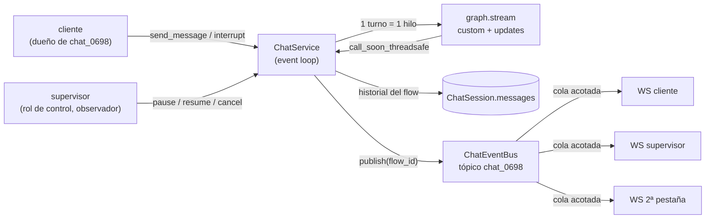

# Chat de soporte en tiempo real (WebSocket) — Preguntas de diseño

Chat con el agente de soporte `first_line_cx` con respuesta token a token, interrupción, reconexión sin perder el hilo y control de operador (`company-brifing2.md`, Parte 2: `agent_id`, `flow_id` de un flujo `chat_session`, `pause`/`resume`/`cancel`, `control_applied`).

Código de referencia:

| Pieza | Archivo |
|---|---|
| Streaming del LLM (`on_token`, `StreamAborted`) | `data/pipelines/rag.py` |
| Tokens por el modo `custom` del grafo | `services/rag_agent/graph.py` (`_streaming_kwargs`) |
| Productor, historial, bus pub/sub, comandos | `services/api/agent_chat.py` |
| `POST /agent/sessions` + `WS /agent/ws` | `services/api/routes/agent.py` |
| UI (tokens en vivo, interrupción, backoff, rehidratación) | `uis/backoffice/agent-chat/chat.js` |
| Tests | `tests/pipelines/test_agent_chat_ws.py` |
| Contrato y verificación manual | `services/api/README.md` → "Support agent real-time chat (WebSocket)" |

## Contexto: cómo está montado

El turno del agente corre en un hilo (el checkpointer es síncrono) y entrega cada chunk al event loop. Allí `ChatService` actualiza el historial de la sesión y publica **un** evento en el tópico del `flow_id`; cada WebSocket es solo un suscriptor de ese tópico. Eventos: `session_restored`, `message_created`, `generation_started`, `generation_step`, `token_chunk`, `generation_completed`, `generation_interrupted`, `generation_failed`, `control_applied`, `chat_session_closed`, `chat_error`.

## 1. ¿Por qué WebSockets y no lo de la Parte 1 (SSE)?

SSE es un canal **solo servidor → cliente**. Para las notificaciones de RFP bastaba: el navegador no tenía nada que decir mientras escuchaba, y las acciones (subir un PDF, aprobar) eran peticiones HTTP sueltas, sin relación temporal con el stream.

Aquí el requisito que obliga a un canal bidireccional es la **interrupción a mitad de respuesta**: el cliente tiene que hablar *mientras* el servidor sigue emitiendo tokens de esa misma conversación, y el corte tiene que quedar **ordenado** respecto a esos tokens. Lo mismo vale para el nuevo mensaje que sustituye a la respuesta en curso y para `pause`/`resume`/`cancel` del operador (briefing §2), que actúan sobre una generación viva.

Con un WebSocket, tokens y comandos viajan por la misma conexión ordenada y autenticada, ligada a un `flow_id`:

- El servidor recibe `interrupt` (o `send_message`) en el mismo socket por el que emite, deja inactiva la generación en el event loop y publica `generation_interrupted` en el mismo flujo ordenado. El cliente sabe sin ambigüedad que **después de ese frame no llega ningún `token_chunk` de ese `message_id`**: no tiene que reconciliar dos canales.
- La autenticación y el vínculo con la sesión se resuelven una vez en el handshake (`?token=` + `?flow_id=`), no en cada comando.
- No hay una petición HTTP nueva (con su handshake y su hueco en el límite de ~6 conexiones HTTP/1.1 por origen, ya ocupado en parte por streams abiertos) para cada interrupción o tecla de control.

Se podría montar con SSE + `POST /interrupt`. Pero habría dos canales sin orden común: un `token_chunk` puede llegar por el SSE *después* del `200` del POST, y la UI tendría que deduplicar por `message_id` y por tiempo. Además habría que correlacionar cada POST con el stream correcto y autenticar las dos rutas. El WebSocket elimina esa carrera en vez de esconderla.

Lo que sí se reutilizó de la Parte 1: eventos con nombre propio (nunca un `message` genérico), payload JSON con los identificadores del briefing, broker por proceso con colas acotadas por suscriptor, backoff progresivo en la UI y el mismo JWT del backoffice. Lo que cambia es la recuperación. En la Parte 1 era *replay* de frames (`Last-Event-ID`). Aquí es una **rehidratación**: los tokens ya están agregados en mensajes del historial, así que al reconectar se manda un snapshot (`session_restored`) en vez de reproducir miles de `token_chunk`.

## 2. Varios clientes en la misma sesión (p. ej. un supervisor)

**Las llamadas al agente las producen los comandos, nunca las suscripciones.** Un `send_message` crea exactamente un turno (un hilo, un `graph.stream`, una llamada al LLM), sin importar cuántos sockets estén mirando ese `flow_id`. Conectarse solo hace `subscribe(flow_id)` en el bus.

Cómo se garantiza que todos reciben lo mismo:

- **Un único productor por sesión, fan-out en el bus.** Cada chunk se convierte en un único frame (`{"event", "data"}`), que se deja en la cola de cada suscriptor del tópico. Todas las publicaciones ocurren en el event loop, y cada cola es FIFO: todos ven los mismos eventos **en el mismo orden**.
- **Alta atómica.** Al conectar, `session.snapshot()` y `bus.subscribe()` se ejecutan en el mismo paso del event loop, sin `await` entre medias. Todo evento posterior al snapshot llega por la cola, ninguno se pierde y ninguno se repite. Un supervisor que entra a mitad de respuesta recibe en `session_restored` el parcial y la `generation` en curso, y después los tokens que faltan.
- **Un suscriptor lento no frena a nadie.** La cola es acotada (1000 frames). Si se desborda, ese suscriptor se cierra con `4408`: perder un token corrompería el mensaje, así que no se descarta en silencio. Al reconectar se rehidrata. El productor y los demás suscriptores no esperan.
- **Supervisor.** Un usuario con rol de control (`AGENT_CONTROL_ROLES`, briefing §3: ingeniería u operaciones) puede conectarse al `flow_id` de otro usuario como **observador**. Recibe el mismo tópico y puede usar `pause`/`resume`/`cancel` (el `control_applied` lo ven todos los suscriptores). En cambio, `send_message`/`interrupt` le devuelven `chat_error` `read_only`: no escribe como el cliente ni dispara turnos. Cualquier otro usuario recibe `4403`. En la UI se abre con `?flow_id=chat_…`.

Evidencia: `test_supervisor_observes_same_events_without_extra_agent_calls` comprueba que cliente y supervisor reciben listas de frames idénticas y que el grafo se llama una sola vez. En la verificación manual con dos navegadores, el stub del LLM registró **1** llamada para los dos espectadores; el supervisor vio los tokens en vivo y su pausa llegó al cliente.

Límite: bus e historial viven en el proceso (un worker). Con varios workers, el tópico iría a Redis pub/sub o `LISTEN/NOTIFY` y el historial a la base de datos. El turno seguiría corriendo en **un** worker (el que recibió el comando), así que tampoco ahí se duplicarían llamadas.

## 3. Abort del stream vs. `interrupt()` de LangGraph

**No se usa `interrupt()`.** Son mecanismos con fines distintos:

- `interrupt()` (HITL) **pausa el grafo de forma persistente**: guarda un checkpoint y espera un `Command(resume=…)` que le *responda* para continuar desde ese nodo. En este repo se usa en la aprobación por departamento del pipeline de RFP, que no se tocó.
- Lo que pide el chat es **descartar** una generación: el usuario no contesta una pregunta del grafo, cambia de tema. No hay nada que reanudar.

Cómo se hace el abort:

1. El hilo del turno consulta una compuerta (`ChatControl.gate`) **antes de cada token** (dentro de `on_token` en `generate`/`casual`) y **entre nodos**.
2. Al interrumpir, en el event loop: la generación se marca inactiva (cualquier chunk que ya estuviera en vuelo se descarta, así que no se publica ningún `token_chunk` más de ese `message_id`); el mensaje pasa a `interrupted`; se publica `generation_interrupted` con el `content` parcial y el `reason` (`new_input`, `user_interrupt` o `cancelled`).
3. La compuerta lanza `StreamAborted`. Esa excepción atraviesa `generate_answer` (que no se la traga, a diferencia de los errores del LLM), sale del `with client.stream(...)` y **cierra la respuesta HTTP en streaming del LLM**. El hilo termina y `tracing.abort_run` cierra el trace de esa corrida.

El `pause`/`resume` del operador sobre `first_line_cx` tampoco usa `interrupt()`: según el briefing §2, *"la generación continúa — sin necesidad de repetir un checkpoint"*. Es la misma compuerta, pero bloqueando el hilo en memoria en vez de abortarlo. (Para `rfp_pipeline` el briefing pide reutilizar el checkpointing del HITL; eso queda fuera de este canal.)

**El mensaje parcial** se conserva tal cual se mostró: mismo `message_id`, `status: interrupted`, `content` = los tokens ya emitidos. Nunca se sobrescribe ni se borra. Sigue en el historial y en cada `session_restored`, y la UI lo deja visible con la etiqueta "Interrumpida".

**El siguiente turno** es un mensaje nuevo:

- Primero `message_created` (el nuevo input del usuario) y luego `generation_started` con un `message_id` nuevo y `reply_to` = ese input. El grafo se ejecuta con `question = new_input` sobre el mismo `thread_id` (`flow_id`).
- El turno nuevo **espera a que salga el hilo abortado** antes de empezar, para que nunca haya dos corridas sobre el mismo `thread_id` en el checkpointer. La espera suele ser corta: el hilo abortado sale en el siguiente token o nodo.
- La corrida abortada deja como mucho el checkpoint de su último paso completo. La siguiente arranca desde `START` con su propio input, así que nada del parcial se cuela en el estado del grafo.

Límite: el agente es stateless por corrida (diseño previo del grafo): recibe la pregunta nueva, no el historial completo ni el parcial interrumpido como contexto. El hilo de LangGraph solo arrastra la memoria por propuesta (`remember`/`memorize`).

Evidencia: `test_new_input_mid_response_interrupts_and_starts_new_turn` y `test_interrupt_command_without_new_input`. Con un cliente WebSocket directo contra la app real: 0 `token_chunk` del `message_id` original tras `generation_interrupted`; parcial `"Son las "`; primer token del turno nuevo ~0,5 s después.
