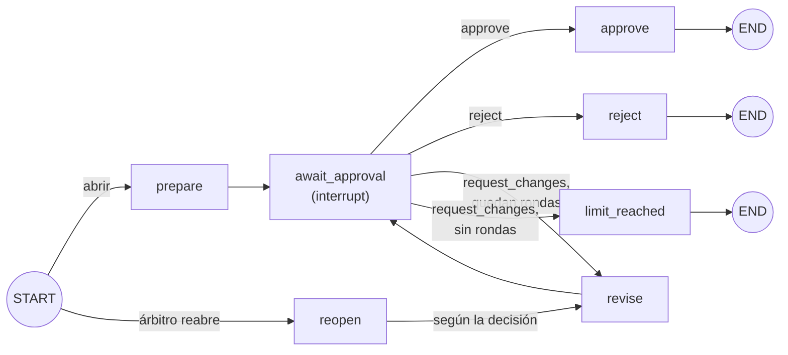

# RFP Parte 3 — Preguntas de diseño

Aprobación humana por departamento, arbitraje y cierre del documento (Hito 9, `trackflow.BRIEFING.md` §2.1, §2.3, §6 y §7).

Código de referencia:

| Pieza | Archivo |
|---|---|
| Grafos (rama por departamento + coordinador) | `data/pipelines/rfp_intake/approval_graph.py` |
| Validación, resume, apertura y cierre | `data/pipelines/rfp_intake/approval.py` |
| Triggers de conflicto §7 | `data/pipelines/rfp_intake/conflicts.py` |
| Checkpointer (Postgres / SQLite) | `data/pipelines/checkpointer.py` |
| API | `services/api/routes/rfp.py` |
| UI | `uis/backoffice/rfp/` |
| Tests | `tests/pipelines/test_rfp_approval.py`, `tests/pipelines/test_rfp_intake_ui.py` |

Preguntas de diseño de partes anteriores (Claude Docs):

- Parte 1: https://claude.ai/artifact/CJmEVe8dqq79Ho84L8BReM
- Parte 2: https://claude.ai/artifact/YG4sSNSWBHSCnBAFLd4gMc

## Contexto: cómo está montada la aprobación

Cada sección activa se aprueba en su propia rama del grafo, con su propio `thread_id` en el checkpointer (`rfp-{ticket_id}:{department}`). Un grafo coordinador por ticket (`rfp-{ticket_id}`) abre las ramas en paralelo, recoge su estado, detecta conflictos, arbitra y cierra el documento.

## 1. ¿Qué pasa si un departamento rechaza su sección después de la interrupción?

**Ni vuelve al generador de la Parte 2 ni hace falta una nueva ejecución del flujo.** El rechazo cierra solo esa rama:

- La rama llega a `END` y la sección queda `rechazada` en `department_sections`, con el responsable y su comentario (obligatorio al rechazar).
- Las demás ramas siguen independientes: se pueden aprobar o pedir cambios.
- El coordinador deja el ticket en `esperando_aprobación` con el motivo "rechazadas (sin documento final): …". No se genera documento final: el BRIEFING (§6) exige que todas las secciones activas estén aprobadas.

Las tres respuestas posibles tienen efectos distintos:

| Decisión | Efecto en la rama |
|---|---|
| `approve` | Registra la aprobación y quita la cabecera "BORRADOR PROVISIONAL" de la Parte 2. Cierra la rama. |
| `request_changes` | Es la única que vuelve a generar. El nodo `revise` llama al mismo agente generador del departamento con el comentario como feedback y reevalúa con los evaluadores de la Parte 2. Después vuelve a interrumpirse. No re-ejecuta el grafo de la Parte 2. |
| `reject` | Cierre definitivo de la rama. |

El ciclo `request_changes → revise → await_approval` tiene un máximo de rondas por sección (`RFP_MAX_APPROVAL_ROUNDS`, 3 por defecto). Las reescrituras que fuerza el arbitraje cuentan también. Si se pide otro cambio con las rondas agotadas, la rama pasa por `limit_reached` y la sección queda rechazada.

**Hueco abierto.** Hoy no hay forma de que una persona reabra una sección rechazada:

- La entrada `reopen` del grafo solo la usa el árbitro.
- `open_approval` es idempotente y no reinicia ramas.
- La Parte 2 no se puede regenerar una vez abierta la Parte 3.

En la práctica, un rechazo humano bloquea el ticket. La solución prevista es pequeña: un endpoint que invoque la rama con `{"reopen": request_changes}`. Reutiliza la entrada que ya existe, sin ejecución nueva.

## 2. ¿Qué información mínima necesita ver un humano en el punto de aprobación?

El responsable debe poder decidir sin releer el documento completo. Lo mínimo:

1. **Qué aprueba y para quién:** cliente, país, moneda, volumen mensual y servicios pedidos.
2. **Veredicto de los evaluadores:** si pasa, qué reglas de §5 fallaron y si la sección es provisional (agotó la Parte 2 sin pasar).
3. **Conflictos §7 que le afectan:** trigger, detalle, árbitro y la restricción impuesta (por ejemplo, "volumen limitado a 3.000 pedidos/mes").
4. **Lo que solo él puede validar:** los parámetros del catálogo marcados `param:<responsable>`, sin respaldo en la base de conocimiento. Ejemplos: Ana valida el SLA del 99 % y Sofía las 72 h de procesamiento de devoluciones.
5. **Qué cambió desde la ronda anterior** y en qué ronda va (x de 3).
6. **Preguntas abiertas al cliente** de esa sección.

Qué cubre hoy la implementación:

| Información | Payload del `interrupt` | UI (`uis/backoffice/rfp`) |
|---|---|---|
| Responsable que decide | `approver` | Sí, fijo en el formulario |
| Ronda actual / máximo | `round`, `max_rounds` | Sí |
| Decisiones admitidas | `allowed_decisions` | Sí |
| Veredicto de evaluadores | `evaluation_passed` | Sí, con reglas fallidas |
| Sección provisional | `provisional` | Sí |
| Desde cuándo espera | `ready_at` | Sí, como tiempo hasta la decisión (KPI §3) |
| Datos del cliente | No | Sí, en el detalle del ticket |
| Conflictos y arbitrajes | No | Sí |
| Historial de decisiones | No | Sí |
| Borrador | No | Sí, desplegable |
| Parámetros `param:<responsable>` | No | **No** |
| Diff con la ronda anterior | No | **No** |

Pendiente:

- Mostrar los parámetros a validar por cada responsable.
- Mostrar un diff entre rondas.
- Que el payload del `interrupt` sea autosuficiente (datos del cliente, hechos y conflictos de la sección) para clientes que no sean la UI.

## 3. ¿Cómo se detectan los triggers de conflicto en estado estructurado?

Los triggers no comparan texto libre entre secciones. `conflicts.section_facts()` convierte cada sección en un registro tipado y `detect_conflicts()` aplica la regla de cada trigger sobre esos registros:

| Hecho | Origen |
|---|---|
| Moneda esperada | `client_country` de la Parte 1 (campo estructurado): US → USD, Spain → EUR |
| `currencies` | Monedas de la sección: encabezado `### Precios (XXX)` + importes |
| `returns_breaches` | La misma regla `returns-min-48h` del evaluador de cumplimiento |
| `committed_capacity` | Capacidad mensual que declara warehouse |
| `assumed_volume` | Volumen que asume lastmile (el tope ofertado, si existe, o el de la RFP) |

| Trigger (§7) | Dispara cuando | Árbitro fijo | Restricción aplicada |
|---|---|---|---|
| `volume-vs-capacity` | `assumed_volume` > `committed_capacity` | Miguel Torres | `volume_cap` en lastmile |
| `returns-sla-breach` | Alguna sección con `returns_breaches` | Sofía Ramos en reverse; Miguel Torres en otra sección | Reescribir sin la promesa < 48 h |
| `currency-mismatch` | Moneda ≠ la del país, o dos secciones con monedas distintas | Miguel Torres | `currency` forzada a la del país |

Por qué el nodo de arbitraje es real y no decorativo:

- Su salida es una decisión estructurada (`request_changes` o `reject`, árbitro fijo, `triggers`, `constraints`). No hay negociación entre agentes ni LLM.
- Esa decisión reanuda la rama ofensora si está esperando, o la reabre si ya estaba aprobada.
- La reescritura aplica las restricciones en el `SectionBrief` del generador.
- El coordinador vuelve a detectar después de cada ronda, con un máximo de `RFP_MAX_ARBITRATION_ROUNDS` (3). Si el conflicto sigue, el árbitro rechaza las secciones ofensoras.
- Mientras una sección sea ofensora de un conflicto abierto, no se puede aprobar (409).
- Los tests comprueban el efecto, no solo el registro. Tras arbitrar, warehouse queda solo en USD, lastmile dice "se limita a 3.000 pedidos/mes" y la promesa de 24 h desaparece.

**Debilidades reconocidas:**

- Los hechos se extraen con expresiones regulares sobre el Markdown del borrador. Son deterministas, pero frágiles si un LLM parafrasea.
- Con el generador de plantillas, `volume-vs-capacity` no salta nunca: warehouse no compromete una cifra de capacidad porque la base de conocimiento no la tiene. Los tests lo ejercitan con un redactor que sí la declara.

**Mejora prevista:** que cada generador devuelva, junto al borrador, un objeto `commitments` tipado (capacidad, volumen, moneda, horas de devolución). El evaluador de cumplimiento comprobaría que el texto concuerda con ese objeto, y los triggers se dispararían sobre él en lugar de sobre el texto.
