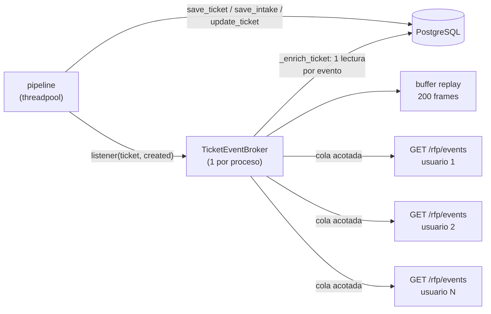

# RFP en tiempo real (SSE) — Preguntas de diseño

Notificación de tickets de RFP en el dashboard del backoffice sin polling (`trackflow.BRIEFING.md` §2.3 para el Ticket y sus estados).

Código de referencia:

| Pieza | Archivo |
|---|---|
| Aviso del pipeline (observadores del ticket) | `data/pipelines/rfp_intake/db.py` |
| Broker SSE (fan-out, replay, `rfp_resync`) | `services/api/rfp_events.py` |
| Endpoint `GET /rfp/events` | `services/api/routes/rfp.py` |
| UI (lector `fetch`, backoff, deduplicación) | `uis/backoffice/rfp/rfp.js` |
| Tests | `tests/pipelines/test_rfp_events.py`, `tests/pipelines/test_rfp_intake_ui.py` |
| Contrato y verificación manual | `services/api/README.md` → "RFP real-time notifications (SSE)" |

## Contexto: cómo está montado

El pipeline avisa tras cada commit del ticket. El broker serializa el frame **una vez**, lo guarda en el buffer de replay y lo deja en la cola de cada conexión. Eventos: `rfp_ticket_created` (estado inicial `analizando`), `rfp_ticket_updated`, `rfp_resync`.

## 1. Dos (o 50) personas abren el dashboard a la vez: ¿conexiones independientes o capa intermedia?

**Las dos cosas, cada una en su nivel.**

- **Conexión independiente**: cada pestaña abre su propio `GET /rfp/events` con su propio JWT, su propia cola y su propia posición (`Last-Event-ID`). Así, si un cliente va lento o se reconecta, los demás no se enteran. Un cliente lento solo pierde lo más antiguo de **su** cola (100 frames), y lo recupera al reconectar.
- **Capa intermedia compartida**: todas las conexiones cuelgan del mismo `TicketEventBroker`. El origen del evento (el observador en `db.py`) y el trabajo caro (leer los metadatos con `_enrich_ticket` y serializar el JSON) ocurren **una sola vez por evento**, no una por conexión. Ninguna conexión consulta la base de datos para enterarse de cambios: ese era justo el coste del polling.

**Con 50 personas:**

| Aspecto | Qué pasa | ¿Problema? |
|---|---|---|
| Memoria/CPU del servidor | 50 tareas asyncio en espera, 50 colas de ≤100 frames de ~1 KB. Un evento son 50 `put_nowait`. Un ping cada 15 s por conexión. | No. Una conexión SSE ociosa no consume CPU. |
| Base de datos | 1 lectura por evento, la misma con 1 que con 50 clientes. Antes, mientras hubiera tickets en curso, el polling hacía 50 × (1 lista cada 3 s), más 1 detalle cada 2 s por cada subida en espera. | Mejora clara. |
| Varios workers de uvicorn | El broker vive en un proceso: un usuario conectado al worker A no ve los tickets que procesa el worker B. | **Sí.** Hoy hay que correr un solo worker. Al escalar, el broker de cada worker debe alimentarse de un bus compartido: `LISTEN/NOTIFY` de PostgreSQL (ya tenemos Supabase) o Redis pub/sub (ya está en el stack para Celery). Las conexiones siguen siendo locales a su worker. |
| Reinicio del servidor | Las 50 pestañas reconectan, reciben `rfp_resync` y piden `GET /rfp/tickets` casi a la vez. | Pico puntual de 50 lecturas. El backoff empieza en 1 s **sin jitter**, así que llegan sincronizadas. Mejora pendiente: añadir jitter aleatorio al backoff. |
| Navegador | En HTTP/1.1, el navegador abre como mucho 6 conexiones por origen. Cada pestaña del dashboard ocupa una. | Con muchas pestañas del mismo usuario se bloquean otras peticiones a la API. Se resuelve sirviendo la API por HTTP/2 detrás del proxy. |
| Proxy delante de la API | Puede acumular el stream en un buffer o cortar conexiones inactivas. | Mitigado con `X-Accel-Buffering: no`, `Cache-Control: no-cache` y el ping de 15 s (por debajo de los 60 s típicos de timeout por inactividad). |

## 2. ¿Qué estrategia de recuperación se eligió y cómo se evitan duplicados?

**Last-Event-ID con replay corto en el servidor, y refetch como último recurso (`rfp_resync`).**

1. Cada frame lleva `id: <epoch>-<seq>`. `epoch` identifica el proceso del servidor y `seq` es un contador.
2. El broker guarda los últimos 200 frames.
3. Al reconectar, la UI manda `Last-Event-ID` y el servidor reenvía primero los frames posteriores a ese id; luego sigue en vivo.
4. Si el id es de otro `epoch` (el servidor se reinició), ya salió del buffer o no es válido, el servidor manda `rfp_resync`. Solo entonces la UI vuelve a pedir `GET /rfp/tickets`. También lo hace en la primera conexión de la página, cuando todavía no tiene ningún id.

Detección del corte en el cliente: con un corte de red, el `fetch` abierto no falla solo (la conexión TCP queda medio abierta). La UI corta el stream cuando el navegador emite `offline` o cuando no llega nada en 45 s (tres `: ping` perdidos), y entra en el backoff. El evento `online` adelanta el siguiente reintento.

Elegí replay frente a "refetch y luego SSE" porque, en la reconexión normal (un corte de red), no hace falta volver a pedir la lista completa: llegan solo los eventos que faltan, en orden. El refetch queda para el caso en que el replay no puede ser fiable, y el servidor lo pide de forma explícita con `rfp_resync` en vez de que el cliente lo adivine.

**Cómo se evitan los duplicados:**

- **Servidor:** la suscripción, la copia del buffer de replay y la publicación comparten el mismo lock. Cada frame llega a una conexión **o** por replay **o** por la cola, nunca por las dos (`test_frame_is_replayed_or_queued_never_both`).
- **Cliente:** la tabla es un `Map` por `ticket_id`, con una fila por ticket:
  - un evento de un ticket conocido reemplaza su fila en el sitio, no añade otra;
  - un payload con `updated_at` más antiguo que lo ya pintado se ignora, por si un replay o un resync llega después de un evento más nuevo;
  - la marca "Nueva" solo se pone si el ticket no estaba en el `Map`, así que un replay no vuelve a anunciar un ticket ya visto;
  - un resync fusiona la lista con el `Map` con la misma regla de `updated_at`, sin vaciarlo.

Verificado en `test_reconnect_with_last_event_id_recovers_missed_tickets_once` (HTTP real) y en las E2E de Chromium:

- `test_network_cut_reconnects_with_backoff_and_replays_without_duplicates`: corte de red del navegador con el servidor vivo; reintentos cada vez más espaciados, replay, sin filas duplicadas y sin volver a anunciar el ticket ya visto;
- `test_stream_reconnects_with_backoff_and_recovers_missed_ticket`: la API se cae, los reintentos se espacian cada vez más, el ticket perdido llega por replay y aparece en una sola fila;
- `test_server_restart_triggers_single_resync_without_duplicates`: tras un reinicio llega `rfp_resync`, la lista se pide una única vez y no hay filas duplicadas.

Límite conocido: el buffer vive en memoria y se pierde al reiniciar. No es una pérdida silenciosa, porque el reinicio cambia el `epoch` y fuerza el `rfp_resync`. La base de datos sigue siendo la fuente de verdad.

## 3. ¿Por qué SSE y no WebSockets? ¿Cuándo dejaría de ser la herramienta correcta?

**Por qué SSE encaja aquí:**

- **El flujo va en una sola dirección.** Notificar que llegó un ticket o que cambió de estado es servidor → cliente. El cliente no tiene nada que decir por ese canal.
- **Las acciones ya tienen su canal, y es mejor así.** Aprobar, rechazar o pedir cambios va por `POST /rfp/tickets/{id}/sections/{dep}/decision`. Ese endpoint valida con 422/409, devuelve el estado resultante y es auditable petición a petición. Un mensaje dentro de un socket perdería eso o tendría que reimplementarlo.
- **Es HTTP normal.** Reutiliza la misma dependencia `get_current_user` (Bearer JWT), el mismo CORS, el mismo router de FastAPI y los mismos proxies. Con HTTP/2 se multiplexa con el resto de peticiones. No requiere dependencias nuevas: es un `StreamingResponse`.
- **La recuperación viene en el protocolo.** `id:`, `retry:` y `Last-Event-ID` son parte de SSE, y nuestro replay se apoya en ellos. Con WebSockets habría que inventar ids, acuses y replay a mano.
- Un matiz honesto: como `EventSource` no permite enviar `Authorization`, leemos el stream con `fetch` y reimplementamos el backoff. Aun así es mucho menos que montar un protocolo sobre WebSocket, que tiene el mismo problema de cabeceras en el navegador.

**Cuándo dejaría de serlo:**

Que alguien pueda *reaccionar* al ticket desde el dashboard no basta para cambiar. Una reacción puntual (aprobar, rechazar o reasignar) sigue siendo mejor como un POST validado, con el resultado volviendo por SSE a todos los demás. WebSockets empezaría a compensar cuando el cliente tenga que hablar **con frecuencia y con estado ligado a la conexión** por el mismo canal, por ejemplo:

- **Presencia y bloqueos suaves:** "Ana está revisando la sección de warehouse", con un latido del cliente mientras tiene el ticket abierto, para que nadie decida a la vez sobre la misma sección. Como el bloqueo depende de que la conexión siga viva, que el servidor detecte el cierre del socket es justo lo que se necesita.
- **Edición colaborativa del borrador** entre el responsable y Ventas: muchos mensajes pequeños en ambos sentidos, donde importa el orden conjunto de lo que envía el cliente y lo que envía el servidor.
- **Conversación en el propio ticket** (Ventas ↔ departamento) con indicador de "escribiendo".
- Mensajes binarios o un volumen alto del cliente al servidor, donde abrir una petición HTTP por mensaje sería caro.

Incluso entonces, mantendría SSE para las notificaciones de la tabla y usaría WebSocket solo en la vista de detalle del ticket que lo necesite, en lugar de migrar todo el dashboard.
